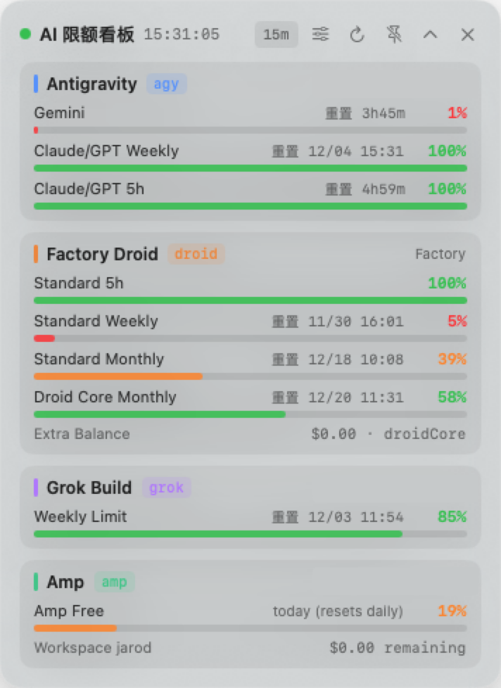
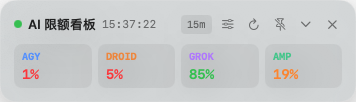
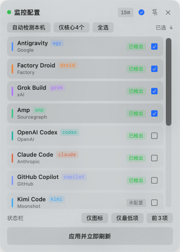

# AI 限额看板

桌面上的一张小卡片。它定时查看本机已经登录的 AI 编程工具，还剩多少额度、什么时候重置。

下面三张图就是程序自己的窗口：浅色毛玻璃卡片。账号已打码。



## 安装

需要 macOS 13 或更高版本，以及 Xcode 命令行工具（里面有 `swiftc`）。

```bash
git clone https://github.com/backtomyfuture/agent-quota-card.git
cd agent-quota-card
bash build.sh
open /Applications/QuotaCard.app
```

装好后，卡片出现在屏幕右上角，菜单栏多一个图标。它不进 Dock。

想开机自己打开：打开 **系统设置 → 通用 → 登录项**，把 QuotaCard 加进去。

## 怎么用

卡片可以拖走，位置会记住。顶部按钮从左到右是：

- **绿点**：空闲。正在刷新时变成橙色。旁边是上次更新的时间。
- **`15m`**：自动刷新间隔。点一下，在 5、10、15、30、60 分钟之间切换。
- **滑杆**：选择要监控哪些工具。
- **刷新**：马上再查一次。
- **图钉**：蓝色表示一直浮在最前面。再点一次回到普通窗口。
- **箭头**：收成摘要，或展开每条额度。
- **关闭**：先把卡片藏起来。菜单栏图标还在，点一下再打开。

收起来以后，每个工具只留一个百分比，取的是它里面最低的那一项。绿色还够用，橙色不多了，红色快用完。



点滑杆可以改监控范围：



- **自动检测本机**：只勾选这台电脑上已经安装并登录的工具。
- **仅核心 4 个**：Antigravity、Factory Droid、Grok、Amp。
- **全选**：15 个都看。

同一页底部可以改菜单栏：只显示图标、只显示最低的一项，或显示前 3 项。鼠标停在菜单栏图标上，能看到全部。

左键点菜单栏图标，显示或隐藏卡片。右键可以刷新、改频率，或退出。

改完点 **应用并立即刷新**。

## 支持哪些工具

没安装或没登录的会标成「未配置」，可以不选。

| 工具 | 命令 | 能看到 |
| --- | --- | --- |
| Antigravity | `agy` | 几小时额度和每周额度 |
| Factory Droid | `droid` | 几小时、每周，以及额外余额 |
| Grok Build | `grok` | 每周额度 |
| Amp | `amp` | 当天免费额度 |
| OpenAI Codex | `codex` | 用量窗口 |
| Claude Code | `claude` | 5 小时和 7 天 |
| GitHub Copilot | `copilot` | 额度快照 |
| Kimi Code | `kimi` | 用量 |
| Gemini CLI | `gemini` | 额度 |
| Cursor | `cursor` | 用量 |
| Freebuff | `freebuff` | 用量 |
| Amazon Kiro | `kiro` | 用量上限 |
| GLM Coding Plan | `glm` | 套餐额度 |
| DeepSeek | `deepseek` | 余额 |
| OpenRouter | `openrouter` | 余额 |

查 Factory Droid 时，如果登录信息是加密保存的，电脑上需要有 Node.js。其他工具只用系统自带的 Python 3。

## 只在终端里看

采集脚本也可以单独用，结果是 JSON。

```bash
python3 collector/quota_collector.py
python3 collector/quota_collector.py --providers agy,droid,grok,amp
```

- `--catalog`：列出全部工具，并标出这台电脑哪些已经登录。
- `--all`：不管有没有登录，15 个都查一遍。

## 隐私

只读取这些工具已经保存在你电脑上的登录状态，向它们各自的官方接口查询额度。项目没有自己的服务器，也不会把数据发到别处。

## License

[MIT](LICENSE)
